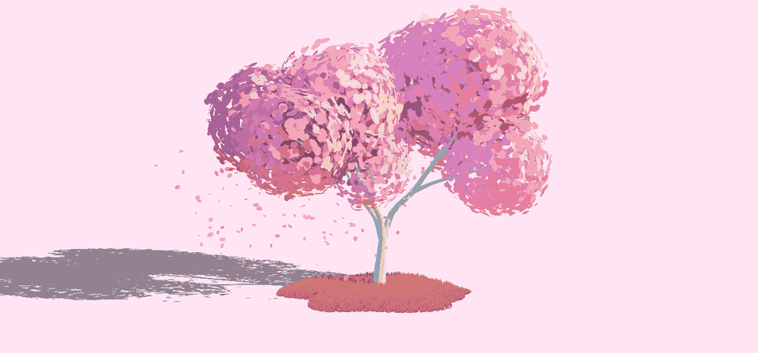

# Just a simple tree



A procedural anime-style tree for three.js, exported as a `.glb` (with
levels of detail if you like), a picture, a sprite sheet or an impostor. Five
species: oak, pine, cypress, weeping willow and bush. Everything is
generated from a seed. Nothing is modelled or loaded, and the leaf textures
are painted in code at startup, unless you drop an image of your own on the
leaves.

## Quick start

```sh
pnpm install
pnpm dev
```

Pick a species and a theme, tune the tree in the panel, then click
**export** and pick what to save. The app renders with WebGPU and falls
back to WebGL2.

## Using the export

**export** opens a menu of five exports, in two groups, 3D models and
images; hover one to see what it's for. The panel's **Export** section sets
how each is made, and **export settings…** at the bottom of the menu opens
it. Its **image format** saves the picture and the sprite sheet as PNG or
lossless WebP; a browser that can't write WebP, like Safari, saves a PNG:

- **tree** (`.glb`): the tree as you see it, as meshes, below.
- **tree + LODs** (`.glb`): the tree and lighter copies of it for farther
  away, 2 to 4 levels, 3 to start with, and the impostor as the last level
  unless **impostor level** is unticked. See [Levels of detail](#levels-of-detail).
- **impostor** (`.glb`): one quad and an atlas of views from all over the sky
  above the tree, for trees far away. See [Impostors](#impostors).
- **picture** (`.png` or `.webp`): the view from the camera, the floor's shadow, the
  grass and the falling leaves included, 1024, 2048 or 4096 pixels on its
  long side. It's RGB on the theme's background, or RGBA on a clear one
  with **transparent (RGBA)** ticked.
- **sprite sheet** (`.png` or `.webp`): the tree from 4, 8 or 16 bearings round it, on a
  clear background, for 2D and 2.5D games. See [Sprite sheets](#sprite-sheets).

The pictures, sprites and impostor are drawn with the tree still and fully
grown, lit by the sun as it is when you export.

The tree's GLB holds two meshes with a plain `MeshStandardMaterial`, so it opens in
any glTF viewer or engine:

- **`wood`**: the branches, with smooth normals. A bush has none.
- **`leaves`**: alpha-masked, double-sided cards with their clumps' normals,
  so each clump shades as one soft volume. The gradient and AO are baked
  into the vertex colours for the sun at export time.

The tree is exported without wind, with its foot at the origin.

### Cel shading

Each material stores its cel ramp in its glTF `extras`, so after loading
it's in `material.userData.celRamp`: `[threshold, colour]` pairs, from
shadow to light. `celShade` rebuilds the app's look from it:

```js
gltf.scene.traverse((object) => {
  if (object.isMesh) celShade(object)
})
```

The thresholds are tuned to the app's lighting. Match it, or the bands
shift:

```js
renderer.toneMapping = THREE.NeutralToneMapping
renderer.shadowMap.enabled = true

const sun = new THREE.DirectionalLight('#fff3df', 5)
sun.position.set(23, 14, 12.5)
sun.castShadow = true
sun.shadow.mapSize.set(2048, 2048)
sun.shadow.camera.left = sun.shadow.camera.bottom = -10
sun.shadow.camera.right = sun.shadow.camera.top = 10
sun.shadow.bias = -0.0005 // avoids acne on the cards
sun.shadow.normalBias = 0.02
scene.add(sun, new THREE.HemisphereLight('#bfd8ff', '#6b5a45', 1))
```

<details>
<summary><code>celShade</code> for <code>WebGLRenderer</code></summary>

```js
import * as THREE from 'three'

// The cel look of Just a simple tree, on a mesh from its GLB, for
// WebGLRenderer: the light picks a colour from the ramp in the material's
// extras, tinted by the light's colour, then the vertex colours shade it
export function celShade(mesh) {
  const material = mesh.material
  const ramp = material.userData.celRamp
  if (!ramp) return
  const count = ramp.length
  material.color.setRGB(0.8, 0.8, 0.8) // the ramp's band edges expect this albedo
  material.onBeforeCompile = (shader) => {
    shader.uniforms.rampAt = { value: ramp.map(([at]) => at) }
    shader.uniforms.rampColor = { value: ramp.map(([, hex]) => new THREE.Color(hex)) }
    shader.uniforms.shadeScale = { value: material.userData.shadeScale ?? 1 }
    shader.fragmentShader = shader.fragmentShader
      .replace(
        '#include <common>',
        `#include <common>
uniform float rampAt[${count}];
uniform vec3 rampColor[${count}];
uniform float shadeScale;`,
      )
      // The vertex colours shade after the ramp, not the albedo
      .replace('#include <color_fragment>', '')
      .replace(
        '#include <opaque_fragment>',
        `{
  float value = dot(outgoingLight, vec3(0.2126, 0.7152, 0.0722));
  vec3 band = rampColor[0];
  for (int i = 1; i < ${count}; i++) band = mix(band, rampColor[i], step(rampAt[i], value));
  outgoingLight = band * mix(vec3(1.0), outgoingLight / max(value, 1e-4), smoothstep(0.0, 0.02, value));
  #ifdef USE_COLOR
    outgoingLight *= vColor.rgb * shadeScale;
  #endif
}
#include <opaque_fragment>`,
      )
  }
  material.needsUpdate = true
}
```

</details>

<details>
<summary><code>celShade</code> for <code>WebGPURenderer</code></summary>

```js
import * as THREE from 'three/webgpu'
import { attribute, color, dot, float, mix, output, smoothstep, step, vec3, vec4 } from 'three/tsl'

// The cel look of Just a simple tree, on a mesh from its GLB, for
// WebGPURenderer: the light picks a colour from the ramp in the material's
// extras, tinted by the light's colour, then the vertex colours shade it
export function celShade(mesh) {
  const old = mesh.material
  const ramp = old.userData.celRamp
  if (!ramp) return
  const material = new THREE.MeshLambertNodeMaterial({
    color: new THREE.Color().setRGB(0.8, 0.8, 0.8), // the ramp's band edges expect this albedo
    map: old.map,
    alphaTest: old.alphaTest,
    side: old.side,
  })
  const value = dot(output.rgb, vec3(0.2126, 0.7152, 0.0722))
  let band = color(ramp[0][1])
  for (const [at, hex] of ramp.slice(1)) band = mix(band, color(hex), step(at, value))
  const tint = mix(vec3(1), output.rgb.div(value.max(1e-4)), smoothstep(0, 0.02, value))
  const shade = mesh.geometry.attributes.color
    ? attribute('color', 'vec3').mul(old.userData.shadeScale ?? 1)
    : float(1)
  material.outputNode = vec4(band.mul(tint).mul(shade), output.a)
  mesh.material = material
}
```

</details>

Leaves wearing a dropped image in its own colours have that image as their
`map`, cut out by its leaves, and no `celRamp`, so `celShade` leaves them as
they are.

### Recolouring

Pick the colours in the app before exporting, or edit the ramp before
calling `celShade`. Change the colours and keep the thresholds:

```js
const ramp = gltf.scene.getObjectByName('leaves').material.userData.celRamp
ramp[0][1] = '#2f5d3a' // shadow
ramp[1][1] = '#5fa052' // lit
ramp[2][1] = '#c4ec84' // highlight
```

### Custom materials

Any material works. On the leaves, carry over `map`, `alphaTest`, `side`
and `vertexColors`, which hold the cut-out and the baked shading:

```js
const old = leaves.material
leaves.material = new THREE.MeshToonMaterial({
  color: '#7cc35f',
  map: old.map,
  alphaTest: old.alphaTest,
  side: old.side,
  vertexColors: old.vertexColors,
})
```

### Levels of detail

**tree + LODs** writes the tree as nodes `tree_LOD0`, `tree_LOD1` and so
on, as Unity names them. `tree_LOD0` is the full tree, the same as
**tree** gives. Each level after it has fewer sides round each branch and
fewer rings along it, and fewer, bigger leaf cards in one piece. With
**impostor level** ticked, the impostor is the last level. Each level's
extras say which it is: its `level`, its `detail` (`full detail`,
`lighter` or `impostor`), how many `vertices` it holds, and the
`screenCoverage` it shows down to. The panel's **tree + LODs** folder
counts each level's vertices before you export. Only
`tree_LOD0` is in the scene, so a plain viewer shows the full tree. It lists
the other levels in glTF's `MSFT_lod` extension, and the share of the
screen each wants in its `MSFT_screencoverage` extras. Engines that read
`MSFT_lod`, like Babylon.js, switch levels on their own. In three.js, build
a `THREE.LOD` from them:

```js
import * as THREE from 'three'

// A THREE.LOD from a GLB with levels of detail: tree_LOD0 is in the scene,
// and lists the other levels' nodes in its MSFT_lod extension. Each level
// takes over once the camera is farther than its distance
export async function treeLOD(gltf, distances = [0, 25, 50, 90, 140]) {
  const first = gltf.scene.getObjectByName('tree_LOD0')
  const { ids } = first.userData.gltfExtensions.MSFT_lod
  const lod = new THREE.LOD()
  lod.addLevel(first, distances[0])
  for (const [i, id] of ids.entries()) lod.addLevel(await gltf.parser.getDependency('node', id), distances[i + 1])
  return lod
}
```

```js
const gltf = await new GLTFLoader().loadAsync('oak-8967.glb')
scene.add(await treeLOD(gltf))
```

### Impostors

The impostor is a quad called `impostor`, unlit, with an atlas of views of
the tree. Its `userData.impostor` (glTF `extras`) says how the atlas is laid
out:

- `frames`: views a side. Frame `(i, j)`, `i` from the left and `j` from the
  bottom in UV space, is the view from the direction the hemi-octahedral map
  decodes from `(i, j) / (frames - 1) * 2 - 1`: the corners and edges look
  from the horizon, the middle from straight above.
- `center` and `radius`: the sphere round the tree that every view frames.

A plain viewer shows the view from the front. `impostor` turns the quad
towards the camera and shows the view nearest its direction. The views
pop from one to the next rather than blending:

<details>
<summary><code>impostor</code> for <code>WebGLRenderer</code></summary>

```js
import * as THREE from 'three'

// An impostor from Just a simple tree, for WebGLRenderer: its quad turns to
// the view in its atlas nearest the camera's direction, and shows it
export function impostor(mesh) {
  const { frames, radius, center } = mesh.userData.impostor
  mesh.frustumCulled = false
  mesh.material.onBeforeCompile = (shader) => {
    shader.uniforms.frames = { value: frames }
    shader.uniforms.radius = { value: radius }
    shader.uniforms.center = { value: new THREE.Vector3(...center) }
    shader.vertexShader = shader.vertexShader
      .replace(
        '#include <common>',
        `#include <common>
uniform float frames;
uniform float radius;
uniform vec3 center;`,
      )
      .replace(
        '#include <begin_vertex>',
        `// The camera's direction, kept above the horizon, to the nearest frame
vec3 eye = (inverse(modelMatrix) * vec4(cameraPosition, 1.0)).xyz - center;
eye.y = max(eye.y, 0.0);
vec2 p = eye.xz / (abs(eye.x) + abs(eye.y) + abs(eye.z));
vec2 frame = clamp(floor((vec2(p.x + p.y, p.x - p.y) * 0.5 + 0.5) * (frames - 1.0) + 0.5), 0.0, frames - 1.0);
// That frame's direction, and the quad turned to face it
vec2 o = frame / (frames - 1.0) * 2.0 - 1.0;
vec2 q = vec2(o.x + o.y, o.x - o.y) * 0.5;
vec3 look = normalize(vec3(q.x, 1.0 - abs(q.x) - abs(q.y), q.y));
vec3 right = abs(look.y) > 0.999 ? vec3(1.0, 0.0, 0.0) : normalize(cross(vec3(0.0, 1.0, 0.0), look));
vec3 up = cross(look, right);
vec2 corner = (position.xy - center.xy) / radius;
vec3 transformed = center + (right * corner.x + up * corner.y) * radius;
vMapUv = (frame + corner * 0.5 + 0.5) / frames;`,
      )
  }
  mesh.material.needsUpdate = true
}
```

</details>

<details>
<summary><code>impostor</code> for <code>WebGPURenderer</code></summary>

```js
import * as THREE from 'three/webgpu'
import { abs, cameraPosition, cross, float, floor, modelWorldMatrixInverse, normalize, positionGeometry, select, texture, varying, vec2, vec3, vec4 } from 'three/tsl'

// An impostor from Just a simple tree, for WebGPURenderer: its quad turns to
// the view in its atlas nearest the camera's direction, and shows it
export function impostor(mesh) {
  const { frames, radius, center } = mesh.userData.impostor
  const old = mesh.material
  const n = float(frames)
  const c = vec3(...center)
  // The camera's direction, kept above the horizon, to the nearest frame
  const eye = modelWorldMatrixInverse.mul(vec4(cameraPosition, 1)).xyz.sub(c)
  const above = vec3(eye.x, eye.y.max(0), eye.z)
  const p = above.xz.div(abs(above.x).add(abs(above.y)).add(abs(above.z)))
  const frame = floor(vec2(p.x.add(p.y), p.x.sub(p.y)).mul(0.5).add(0.5).mul(n.sub(1)).add(0.5)).clamp(0, n.sub(1))
  // That frame's direction, and the quad turned to face it
  const o = frame.div(n.sub(1)).mul(2).sub(1)
  const q = vec2(o.x.add(o.y), o.x.sub(o.y)).mul(0.5)
  const look = normalize(vec3(q.x, float(1).sub(abs(q.x)).sub(abs(q.y)), q.y))
  const right = select(abs(look.y).greaterThan(0.999), vec3(1, 0, 0), normalize(cross(vec3(0, 1, 0), look)))
  const up = cross(look, right)
  const corner = positionGeometry.xy.sub(c.xy).div(radius)
  const view = texture(old.map, varying(frame.add(corner.mul(0.5).add(0.5)).div(n)))
  const material = new THREE.MeshBasicNodeMaterial({ alphaTest: old.alphaTest, side: old.side })
  material.positionNode = c.add(right.mul(corner.x).add(up.mul(corner.y)).mul(radius))
  material.colorNode = view
  material.opacityNode = view.a
  mesh.material = material
  mesh.frustumCulled = false
}
```

</details>

```js
const gltf = await new GLTFLoader().loadAsync('oak-8967-impostor.glb')
impostor(gltf.scene.getObjectByName('impostor'))
scene.add(gltf.scene)
```

In a GLB with levels of detail, call it on `impostor_LOD3` (or whichever
level is the last).

### Sprite sheets

The frames are square, four to a row, left to right and then top to bottom.
Frame `k` of `n` looks from `k / n` of the way round the tree,
counter-clockwise seen from above, starting from the front (+z), and from
**elevation** degrees above level. Every frame has the same scale, and the
tree's foot is on the same pixel in each, centred near the bottom.

## What it does

- **The tree** grows from a seed, as one of five species, picked with the
  buttons down the left side (hover one for its name), the up and down
  arrow keys or the panel, all from the same crooked, tapered wood with
  rounded tips and collars where branches meet:
  - **oak**: a short trunk splitting into limbs, each branching again;
  - **pine**: one straight trunk ringed by whorls of drooping branches, long
    at the bottom and short at the top, so the crown is a tiered cone of
    flat pads of needles;
  - **cypress**: a tall, narrow flame of short branches climbing steeply
    round a spiral, widest a third of the way up;
  - **willow** (weeping willow): a short, stout trunk splitting into limbs that rise and
    spread like a fountain, hung with long thin strands that arch over and
    fall in curtains towards the ground;
  - **bush**: no wood at all and no falling leaves: a single ball of leaves
    on the ground, or, with more clumps, a low, round dome of them heaped
    up, the big ones in the middle.
- **Each seed has its own character**: besides placing every branch, it
  makes the tree taller or shorter, broader or slimmer, leaning a little and
  heavier on one side, and varies what makes its species: where the pine's
  crown starts and how it droops, where the cypress is widest and how sharp
  its tip is, how wide the willow's dome is and how long its curtains, how
  wide the bush spreads.
  **variety**, in the shape folder, sets how far: at 0 every seed grows its
  species' average tree.
- **The leaves** are flat cards scattered over leaf clumps: one at each free
  branch tip on the oak, flat pads along the pine's branches, round
  clumps packed up the cypress, and long tresses down the willow's strands,
  their leaves pointing down, and round clumps heaped up into the bush. Every species wears the same round leaves;
  the panel's texture can swap them for pointed, oak, pine-needle or willow
  leaves, or for **your image**: drop an image anywhere on the page, or
  **load image…**. A PNG with transparency is cut out by it and keeps its own
  colours, within the cel bands; an image without transparency is read as
  white leaves on black and takes the theme's colours. **colors from** switches
  between the two. The image is kept in the browser, so a link asking for it
  finds it again on the same machine. They borrow the clump's normals instead of their own, so a clump
  shades like one soft ball, and go through a hard-edged cel colour ramp.
- **Ambient occlusion** is worked out per card on the CPU, treating each
  clump as a leafy volume, so the colours depend on the sun and never on the
  camera.
- **Lights**: a sun with shadows and a sky-and-ground hemisphere light; their
  colours tint the bands. The floor only draws the shadow, so it blends into
  any background colour.
- **Grass**: a small round patch at the tree's foot, after the grass of the
  Portfolio2024 island. Every blade is built in the vertex shader, bent,
  turned at random and widened when seen edge on; the patch's ragged rim
  shortens the blades into it. It leans with the wind, goes through the
  tree's cel ramp with the tree's shadow on it, and takes the theme's colours.
- **Wind** sways the whole tree and rocks each leaf card, and swings the
  willow's strands from where they hang, more towards their tips; **falling leaves**
  drift downwind and settle on the floor, simulated with a compute shader.
- **A new tree**: **new tree** at the bottom, or space, picks a new seed,
  at any time, even while a tree is still growing. The old leaves blow
  away on the wind while the tree scales down into its foot. The moment
  the tree is gone, the new one springs up out of the ground, shooting up thin and overshooting short and wide
  before it settles, its branches shooting out and its leaves popping on in
  a soft wave from the trunk to the tips. Picking another species
  brings it up in the same way.
- **Themes**: the round buttons along the top, or the left and right arrow
  keys, switch between blossom, spring, autumn, frost and night. Each sets
  the leaves, the wood, the grass, the background and the shadows. The new theme sweeps over the
  screen from the bottom left to the top right behind a ragged Perlin-noise
  front with a bright edge. When the front reaches the tree it hits it: the
  tree squashes and bounces back, the camera is knocked and shakes, and a
  batch of leaves drops straight down until a gust catches them and blows
  them sideways. Picking again mid-sweep sends a new front after the ones
  still going, and each front knocks its own leaves off.
- **Export**: **export** saves the tree as a GLB, with levels of detail
  and an impostor if asked, a picture, a sprite sheet or an impostor, as
  described in [Using the export](#using-the-export). The GLB holds the wood
  and the leaves; the grass, the floor and the falling leaves stay in the app.

## The panel

Every setting lives in three's WebGPU Inspector (the button at the top
right), one section per part of the scene, each with its own colors and
debug views: the tree (theme, species, its shape, trunk and mesh with the
wireframe; the shape shows only the species' own sliders, and the bush,
which has no wood, hides the wood's sliders, wireframe and colours, and
drops no leaves, so it hides falling leaves too),
the leaves (clumps, cards, shading and normals), wind, the grass (its
size, blades, wind strength, shading and colours), falling leaves, and
the lights (background, sun, sky, shadows, tone mapping), and the export
(the images' format, the tree's levels of detail, the picture's size and
transparency, the sprite sheet's views, and the impostor's).
Each section and folder has its own reset, the filter box finds a setting by
name, and **copy config** copies every value as JSON.

The page's address always holds every setting changed from the start, so
**copy link** (or the address bar) shares this exact tree: opening the link
sets them all again.

## Files

| file | what's in it |
| --- | --- |
| `main.js` | the scene, the panel and the render loop |
| `bar.js` | the buttons at the bottom: new tree, and export with its menu |
| `image-drop.js` | dropping or picking an image for the leaves, and keeping it |
| `themes.js` | the colour themes and the buttons along the top picking them |
| `species-buttons.js` | the buttons down the left picking the species |
| `vertex-count.js` | the card counting the vertices the export will write |
| `stickers.js` | the round sticker buttons both rows are made of |
| `transition.js` | the sweep from one theme to the next |
| `shake.js` | a theme's front hitting the tree: its squash and bounce, the camera's shake, the gust and the leaves knocked off |
| `icons/` | the theme buttons' icons |
| `docs/` | the GIF at the top of this README |
| `wood.js` | the wood every species is built from: branches as tubes, and the growing data |
| `oak.js` | the oak: its branching and leaf clumps, its icon, sliders and settings |
| `pine.js` | the pine: its whorls and leaf clumps, its icon, sliders and settings |
| `cypress.js` | the cypress: its spiral of climbing branches and leaf clumps, its icon, sliders and settings |
| `willow.js` | the willow: its limbs, hanging strands and leaf clumps, its icon, sliders and settings |
| `bush.js` | the bush: its leaf clumps, its icon, sliders and settings |
| `foliage.js` | the leaf cards, their shading, the painted textures and a dropped image's |
| `shading.js` | lights, shadows, cel ramps, tone mapping, wood and floor |
| `grass.js` | the grass patch round the tree's foot |
| `wind.js` | the sway and the leaf flutter |
| `falling-leaves.js` | the falling leaves, on the GPU |
| `regenerate.js` | a new tree, from a new seed or species: the burst, the shrink and the springy pop |
| `glb.js` | the GLB export: the tree, its levels of detail and the impostor |
| `lod.js` | the levels of detail, and the tree's bounds |
| `capture.js` | the picture, the sprite sheet and the impostor's atlas, drawn from the scene |
| `inspector-filter.js` | the filter box for the Inspector |
| `inspector-tools.js` | the reset, copy link and copy config buttons, and the link itself |

## Credits

- The leaf shading follows trungduyng's
  [Anime Tree Tutorial](https://www.youtube.com/watch?v=52sTppv7Y-E) for
  Blender: leaf cards scattered over a bush whose normals they borrow, a cel
  colour ramp, and a gradient and ambient occlusion on top. Here the cards
  are fixed in the world rather than facing the camera.
- The falling leaves build on Bruno Simon's TSL petals lesson in
  [Three.js Journey](https://threejs-journey.com).

## License

[MIT](LICENSE)
